  

  Undergraduate at the Grainger College of Engineering, University of Illinois Urbana-Champaign

  I build software for everyday use: desktop and mobile apps, developer tools, and AI-assisted products.

  

